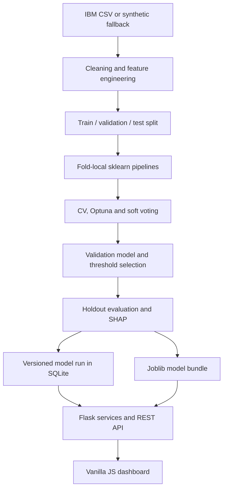

# Churn Studio

**Explainable customer retention intelligence, running on your laptop.**

A complete Flask + SQLite application with a CPU machine-learning pipeline and a responsive, six-page dashboard. No account, API key, GPU, credit card, or paid service is needed. The included model was trained on **7,043 real IBM Telco sample customers**, not synthetic data.

| Untouched test metric | Result |
|---|---:|
| ROC-AUC | **0.8454** |
| PR-AUC (average precision) | **0.6591** |
| Recall | **0.9465** |
| Precision | **0.3907** |
| F1 | **0.5531** |
| Brier score | **0.1353** |
| Business action threshold | **0.085** |

The selected model is **XGBoost**. The 0.84 ROC-AUC target was met. Precision and recall reflect a deliberately broad, high-recall contact policy; the threshold is not a claim that 8.5% is intrinsically “high” churn risk. Read [MODEL_REPORT.md](MODEL_REPORT.md) for comparisons, assumptions, and limitations.

## Quick start

Python **3.12 is recommended** and was tested. Python 3.10+ is supported by dependency markers; retrain when using Python 3.10 because its scikit-learn version differs from the shipped artifact. On macOS, install OpenMP (`brew install libomp`) if LightGBM requires it. Use an ARM-compatible PyTorch build on Apple Silicon; all models still run on CPU.

```bash
python -m venv .venv
# Windows Command Prompt:
.venv\Scripts\activate
# Windows PowerShell: .venv\Scripts\Activate.ps1
# macOS / Linux: source .venv/bin/activate

python -m pip install -r requirements.txt
python run.py
```

Open **http://127.0.0.1:5000**. The default command runs Waitress, not Flask's development server. If the model or populated database is missing, it downloads/generates data and trains automatically before serving. Dependencies need internet for initial installation; the installed application and model work offline.

The artifacts and populated SQLite database are already present in this delivered folder. Generated data/model files are intentionally ignored by git: a fresh checkout automatically rebuilds them. For a new Python/library version, explicitly retrain before serving:

```bash
python run.py download
python run.py train
python run.py serve --port 5000
python run.py test
```

You can also use `python run.py setup` or the equivalent Makefile targets. Run commands from this folder; `run.py` also resolves its own project root when called by absolute path.

## Product tour

- **Overview:** animated KPI counters, contract churn, tenure trend, payment method, risk distribution, and SHAP importance.
- **Predict churn:** sectioned customer form, animated probability gauge, five signed SHAP drivers, and offline retention recommendations.
- **Batch prediction:** drag-and-drop CSV, validation, progress state, results preview, and expiring CSV download. A sample file is linked in the UI.
- **Customers:** SQL-powered search, sorting, risk/contract filters, pagination, and a customer detail dialog.
- **Model insights:** eight model comparisons, ROC and PR curves, confusion matrix, and calibration plot.
- **What-if simulator:** debounced live predictions when tenure, charges, contract, service, or support changes.

Dark/light mode persists in the browser. Layouts adapt to desktop, tablet, and mobile. Controls use labels, focus outlines, a skip link, ARIA status messages, keyboard-accessible native controls/dialogs, and reduced-motion support.

Chart.js 4.4.8 and Inter load from free CDNs. If internet is unavailable, system fonts and readable chart data tables take over. Prediction, SQL analytics, customer browsing, and rule-based advice do not require internet.

## Architecture



```text
app/                  Factory, config, API blueprint, validation/services, SQL connections
src/ml/               Cleaning/features, EDA, PyTorch MLP, training, SHAP explanations
data/                 Download and synthetic scripts, CSV, source metadata, churn.db
sql/                  Schema, indexes, views, named analytics queries
models/               Model bundle, preprocessing, ensemble, threshold, metrics
static/               Responsive CSS, modular JS, example batch CSV
templates/            Jinja application shell
reports/              EDA chart, insights, test and smoke logs
tests/               Pytest coverage, real HTTP smoke, optional browser checks
run.py                setup / download / train / serve / test
MODEL_REPORT.md       Measured comparisons and conclusions
Dockerfile            Optional local container; no hosted service required
```

## Data and SQL

`python run.py download` uses the [IBM public sample CSV](https://raw.githubusercontent.com/IBM/telco-customer-churn-on-icp4d/master/data/Telco-Customer-Churn.csv). Network or parsing failure automatically invokes a reproducible, Telco-like generator with an approximately 26% churn rate. `data/source.json` identifies the source, and the dashboard/model report disclose synthetic runs. Results from synthetic data are not evidence of Telco performance.

The IBM data contains **no support-ticket counts**. The fallback generator includes `SupportTickets`, but that column is deliberately excluded from all trained models for schema compatibility. No imaginary ticket records are appended to IBM customers.

SQLite contains:

| Table / view | Purpose |
|---|---|
| `customers` | Customer ID, contract, tenure, charges, payment, observed churn, JSON profile |
| `predictions` | Customer-linked probability, risk, model run, timestamp |
| `model_runs` | Training timestamp, selected model, provenance, all comparisons/metrics in JSON |
| `latest_predictions` | Latest stored prediction per known customer |
| `cohorts` | Observed churn grouped by tenure; real acquisition dates are unavailable |

Parameterized SQL protects search and filters. Sort fields use a fixed allowlist. Foreign keys, indexes, WAL mode, bounded pages, and request-local connections are enabled. Analytics are served from the SQL files, including metrics/feature importance retrieved from `model_runs` JSON.

“Revenue at risk” is **sum(monthly charges × predicted probability)**, a monthly expected-exposure proxy in USD. It is neither realized lost revenue nor a causal forecast. Historical churn percentages use the dataset labels; predicted risk uses the deployed score and threshold.

## ML methodology and retraining

1. Convert numeric fields, handle blank `TotalCharges`, deduplicate customer IDs.
2. Produce `reports/eda.png` and `reports/EDA_INSIGHTS.md`.
3. Add tenure buckets, historical/current charge ratio, service count, contract flags, and interactions.
4. Split stratified **64% training / 16% validation / 20% test** with fixed seeds.
5. Fit imputation, scaling, and one-hot encoding inside each training-fold pipeline. Neither target nor customer ID enters the model. Inference defaults come from the training split.
6. Compare logistic regression, class-balanced logistic regression, class-balanced random forest, XGBoost, LightGBM, and a CPU PyTorch MLP using **stratified 5-fold CV**.
7. Run **six Optuna trials**, each with 5-fold CV, on logistic regularization. This bounded tuning is intentionally modest.
8. Fit and cross-validate a soft-voting ensemble of the three highest CV-scoring candidates. Selection among all models uses validation ROC-AUC; the ensemble is not automatically deployed if it is worse.
9. Select a business threshold on validation predictions; evaluate the chosen fixed pipeline once on the untouched test set.
10. Calculate global permutation SHAP using 40 validation observations and 32 training-background rows. Local explanations use the exact deployed model in probability units.
11. Log each successful training run with its full comparison in SQLite, save artifacts, and regenerate the report.

The MLP has batch normalization, dropout, AdamW, learning-rate scheduling, and early stopping on a subset of each outer training fold. No GPU path is used. Class weighting is compared to the unweighted baseline; SMOTE is not required.

The selected pipeline stays fitted on the training split so validation-selected thresholds remain consistent. The held-out evaluation does not use portfolio predictions, which include training observations. Run `python run.py train` to reproduce. Training took under a minute in this environment; slower laptops may take several minutes. Stop the web server before retraining, then restart it so its in-memory model matches the current database.

Artifacts:

- `models/churn.joblib`: selected model, training background/defaults, input schema, threshold, run ID, and metrics.
- `models/pipeline.joblib`: selected complete inference pipeline.
- `models/preprocessing.joblib`: selected preprocessing stage when the winner is a standalone pipeline.
- `models/ensemble.joblib`: trained final soft-voting candidate.
- `models/metrics.json` and `models/threshold.json`: human-readable evaluation and policy.

The main inference bundle is published with atomic file replacement. Only load trusted joblib files; pickle-based artifacts execute code on load.

### Business threshold

The assumed value is **$300 × 30% success = $90 per would-be churner contacted**, minus **$10 for every contact**. The validation sweep maximizes that net value. These are assumed economics, not experimentally estimated retention effects. Edit the policy constants in `src/ml/train.py` and retrain for another scenario. Contacting a large portion of the sample is optimal under these assumptions, so High risk is an action-policy label.

## REST API

All API errors return a JSON `error` field with the appropriate HTTP status. CSV download responses intentionally return CSV rather than JSON.

| Method | Endpoint | Parameters / response |
|---|---|---|
| GET | `/api/health` | Database availability and loaded model |
| GET | `/api/schema` | Input categories, numeric ranges, defaults |
| POST | `/api/predict` | JSON customer → probability, risk, threshold, top 5 SHAP reasons, offline advice, defaulted fields |
| POST | `/api/predict/batch` | Multipart `file` CSV → up to 500 predictions and `download_url` |
| GET | `/api/downloads/<token>` | Download result CSV; 15-minute lifetime |
| GET | `/api/customers` | `page`, `page_size` (1–100), `search`, `risk`, `contract`, `sort`, `direction` |
| GET | `/api/customers/<id>` | Profile and current explained prediction |
| GET | `/api/analytics/kpis` | Total customers, observed churn, high-risk count, monthly exposure |
| GET | `/api/analytics/contract` | Observed churn by contract |
| GET | `/api/analytics/tenure` | Observed churn by tenure bucket |
| GET | `/api/analytics/payment` | Observed churn by payment method |
| GET | `/api/analytics/risk` | Stored risk distribution |
| GET | `/api/analytics/feature-importance` | Global SHAP importance from SQL run record |
| GET | `/api/analytics/model-metrics` | Comparisons, held-out metrics, curve coordinates |
| GET | `/api/retention-advice/<id>` | Personalized offline or opt-in online advice |

Single-customer example:

```bash
curl -X POST http://127.0.0.1:5000/api/predict \
  -H "Content-Type: application/json" \
  -d '{"tenure":12,"MonthlyCharges":79,"TotalCharges":948,"Contract":"Month-to-month","InternetService":"Fiber optic","PaymentMethod":"Electronic check"}'
```

The five required fields are `tenure`, `MonthlyCharges`, `Contract`, `InternetService`, and `PaymentMethod`. Optional profile fields use disclosed training-mode defaults. Blank total charges are imputed by the fitted pipeline. Unknown categories, non-finite numeric inputs, invalid ranges, malformed bodies, and oversized files are rejected. Service fields are normalized consistently when no internet/phone service is selected.

Supply a known `customerID` to persist its new score. Anonymous single and batch scenarios return predictions without creating customer records. When rescoring a known ID, use that customer's actual profile; hypothetical changes belong in the simulator and should omit the ID. Batch requests are all-or-nothing and omit SHAP for speed. Exported IDs are escaped against spreadsheet formula injection. Download tokens are random, short-lived, and bounded to 20 cached files.

## Optional free AI

Copy `.env.example` to `.env` if needed. **The default is fully offline.** Rules map the customer profile and SHAP factors to practical, testable actions such as a plan review, voluntary contract offer, onboarding check-in, or technical support call.

For optional natural-language advice, use a provider account restricted to its free tier, leave billing disabled, set `GROQ_API_KEY` or `GEMINI_API_KEY`, and explicitly set `ENABLE_FREE_AI=true`. No paid fallback or account provisioning exists. A failed call, missing key, timeout, or unavailable model silently returns the offline plan. Only suggested actions are sent to the provider; customer IDs and raw profiles are not sent. Keys never enter browser code or logs.

The server cannot independently verify a provider account's billing status. If you require a strict guarantee of zero third-party API usage, keep the default `ENABLE_FREE_AI=false`. See [Gemini free-tier pricing](https://ai.google.dev/gemini-api/docs/pricing) and [Groq rate limits](https://console.groq.com/docs/rate-limits); availability and quotas can change. The model names are configurable via `.env`.

## Testing and screenshots

```bash
python run.py test
python tests/live_smoke.py
```

**49 pytest tests passed** in the implementation environment. Coverage includes the fallback generator, cleaning, preprocessing of unseen categories, artifact consistency, SHAP local accuracy, every API route, every page route, malformed input, CSV download/escaping, pagination/filtering, CORS, rate limits, prediction persistence, and online-advice failure fallback. Test writes use an isolated SQLite backup.

The real HTTP smoke script starts the documented Waitress command and checks six pages, twelve GET API routes, single prediction, and SHAP before stopping the server. Results are in `reports/tests.log` and `reports/live-smoke.log`.

**Screenshots / visual verification:** the environment blocked Chromium process socket creation, so screenshots and browser interaction checks were not completed here. No screenshots are fabricated. An optional reproducible Playwright script is included:

```bash
python -m pip install playwright==1.51.0
python -m playwright install chromium
python tests/browser_smoke.py
```

It exercises predictions, upload, customer search/drawer, the simulator, dark mode, mobile overflow/menu, and the offline CDN fallback. On a normal laptop it saves actual captures to `reports/screenshots/` (`dashboard.png`, `dashboard-dark.png`, `predict.png`, `model-insights.png`, `mobile.png`). Playwright is a development-only dependency, not required by the app. Windows/Linux/macOS UI behavior still needs that browser validation before calling this deployment-ready for external users.

## Free deployment

**The guaranteed zero-service-cost option is local hosting** with `python run.py`. For LAN access use `python run.py serve --host 0.0.0.0`; only do so on a trusted network because this sample workspace has no authentication.

An optional local Docker workflow:

```bash
docker build -t churn-studio .
docker run --rm -p 7860:7860 churn-studio
```

Open http://localhost:7860. For durable Docker data use mounted `/app/data` and `/app/models` directories writable by UID 1000. Do not commit `.env` or upload sensitive customer data in an image.

### PythonAnywhere free Beginner account

[PythonAnywhere's free account](https://www.pythonanywhere.com/pricing/) currently offers one web app; [documented limits](https://help.pythonanywhere.com/pages/FreeAccountsFeatures/) include 512 MiB personal disk, restricted outbound internet, one worker, and monthly web-app expiry. Use the free signup and stop if a provider flow requests billing; no paid tier is needed for the instructions below.

1. Train **locally**, not in the free account's limited CPU allowance. Upload source, static/templates, SQL, `models/churn.joblib`, and a consistent `data/churn.db` backup. For SQLite backup, stop the local server first or use SQLite's backup API; do not copy a live WAL database alone.
2. Create a Python 3.12 virtualenv with system packages available (`python3.12 -m venv --system-site-packages ~/churn-venv`). Install `requirements-serving.txt` with `--no-cache-dir`; this omits PyTorch, Optuna, LightGBM, and training/plotting dependencies for the shipped XGBoost winner. System packages may already supply the scientific stack. Verify matching versions and available disk before installing; if compatible libraries will not fit, remain local instead of upgrading or entering payment details. This constrained hosting path has not been provisioned or tested here.
3. Add a manually configured Flask web app using that virtualenv. Set its WSGI file to:

   ```python
   import sys
   sys.path.insert(0, '/home/YOUR_USERNAME/churn-studio')
   from app import create_app
   application = create_app()
   ```

4. Map `/static/` to `/home/YOUR_USERNAME/churn-studio/static/`, leave free AI disabled, and reload the app. Same-origin browser requests work without a CORS change. If you intentionally use another frontend origin, add that exact origin to `.env`.
5. Confirm `/api/health`, the dashboard, and a prediction. Renew the free web app when required. Retain local backups of SQLite and the artifact.

Do not install the full training stack into a small free-hosting quota. If retraining selects an MLP or an ensemble containing it, the lightweight serving profile is insufficient; deploy locally or use a compatible free environment. Hosting policies change, so this project does not promise an always-on public SaaS for free.

## Operational boundaries

This is a functioning local reference system with production-style structure, validation, logging, headers, and tests; it is **not a completed multi-user production deployment**.

- SQLite, the in-memory rate limiter (120 requests/minute/IP), and batch download cache target **one process**. Restarting clears downloads. Use a trusted reverse proxy and shared limiter/storage before horizontal scaling; do not blindly trust forwarded IP headers.
- No authentication, authorization, tenant isolation, consent workflow, or account system is included. Bind to loopback by default. Never expose real customer records on an open public instance.
- The sample is historical and small. No time-based validation, measured intervention efficacy, drift monitoring, or subgroup fairness audit has been established. Gender and senior status are model inputs; review their use before operational decisions.
- SHAP values are approximate explanations of predictions, not causes. Global importance uses a bounded sample for laptop speed.
- Rate-limited online AI is optional and was tested with a mocked failure, not a real API key. Docker/free-host deployment and Python 3.10/macOS were documented but not executed here.
- Fonts/charts are CDN enhancements with offline data fallbacks. Browser visual verification remains outstanding due to the execution environment restriction described above.
